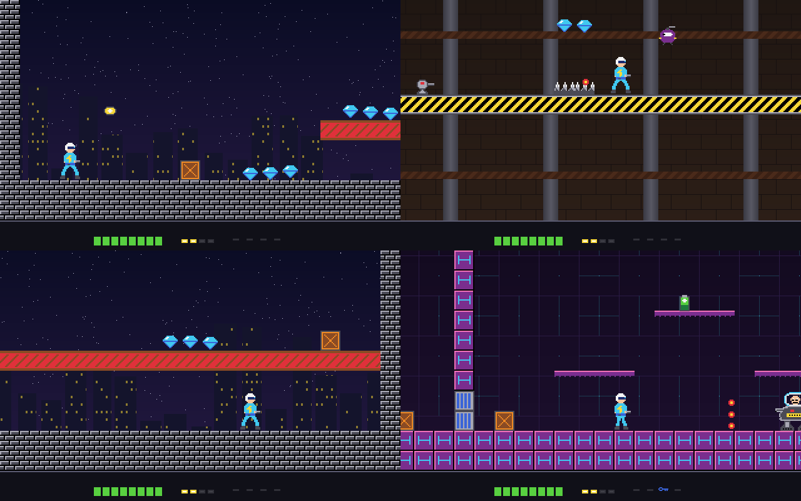
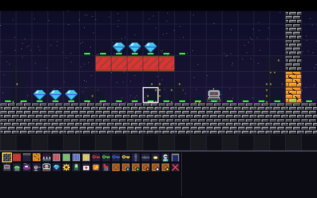
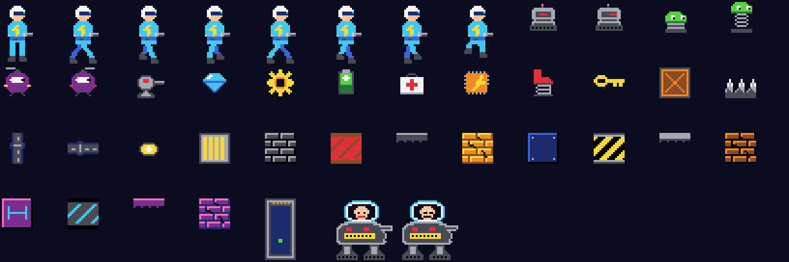

# Jack Volt

A run-and-gun scrolling platform game for Windows, in the spirit of the
early-90s PC shareware platformers. Written in plain C++ with the Win32 API -
no game engine, no extra libraries.

Professor Gearhart's robots have taken over Steel City. Fight through four
levels, find the coloured keys, shoot open the crates and the cracked walls,
and reach the exit - then deal with the professor himself.

## Features

- **Four levels** that scroll every way: Steel City Streets, The Gearworks,
  Skyline Towers and Gearhart's Fortress, with a boss at the end
- **Robots** that walk, hop, fly after you, or sit and shoot
- **Things to find**: coloured keys and doors, crates to shoot open, cracked
  blocks to shoot through, gems and cogs, batteries and medkits, fire power
  (up to four shots at once) and spring boots
- **Three tunes** written for the game, two voices each, and sound effects,
  from a small built-in mixer
- **A level editor** with test play and a **level checker** that explores
  every place Jack can reach, using the game's own physics, and shows anything
  he can't get to
- **High scores**, **gamepad support** (Xbox-style controllers), a resizable
  window and full screen with F11

## Building

You need [Dev-C++](https://github.com/Embarcadero/Dev-Cpp) (the Embarcadero
version, 6.3 or later) on Windows.

1. Download or clone this repository into a folder of its own.
2. Open `Volt.dev` in Dev-C++.
3. Press F11 (Compile & Run).

The project links with `-static` and `-lwinmm`. If Dev-C++ ever reports
`undefined reference to waveOutOpen`, add `-lwinmm` under
Project > Project Options > Parameters > Linker.

Other MinGW-w64 compilers work too, e.g.

    windres volt.rc -O coff -o volt.res
    g++ -O2 *.cpp volt.res -o Volt.exe -mwindows -static -lwinmm

## Playing

| Key | |
|---|---|
| Left / Right | run |
| Space, Alt or Z | jump (hold for higher) |
| Ctrl or X | fire |
| Up | go through the exit |
| P | pause |
| S / M | sound effects / music on or off |
| F11 | full screen |
| H | high scores (on the title screen) |
| E | level editor (on the title screen) |
| Esc | give up, or quit |

On a gamepad: the stick or d-pad moves, A jumps, X or B fires, Y pauses,
Start starts.

You have eight bars of health; robots, their shots and spikes each take one.
Lose them all and you start the level again with the score you had when it
began - there are no lives to run out of.

## Making levels

Press **E** on the title screen. Click to paint, right-click to rub out,
**T** to test-play, **V** to check the level, **Ctrl+S** to save. The help is
on the editor's screen.

Levels are kept in `levels.txt` next to the program, so they can be edited in
Notepad too: one character per map square, with the key at the top of the
file.

## The code

| File | |
|---|---|
| `volt.h` | what all the parts share |
| `main.cpp` | the window, the game loop, keyboard and mouse, full screen |
| `game.cpp` | the rules: Jack, his blaster, the robots, the things to pick up |
| `draw.cpp` | drawing the game, the backdrops, the status bar and title |
| `editor.cpp` | the level editor |
| `checker.cpp` | the level checker |
| `levels.cpp` | reading `levels.txt` |
| `defaults.cpp` | the standard levels |
| `art.cpp` | the pictures, as grids of colour numbers |
| `sound.cpp` | the sound mixer, the effects and the tunes |
| `pad.cpp` | gamepads |
| `scores.cpp` | the high-score table |
| `inputbox.cpp` | a small "type some text" window |
| `volt.rc`, `volt.ico` | the icon and version information |

`gen/make_art.py` and `gen/make_levels.py` are the Python scripts that made
`art.cpp` and `defaults.cpp`; you don't need them to build the game.

## Licence

MIT - see [LICENSE](LICENSE). The game, its characters, artwork, levels and
music are all original.
